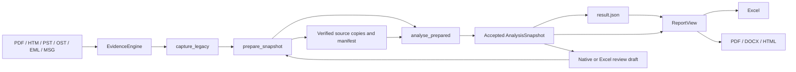

# Architecture

[Documentation index](README.md) · [Development](DEVELOPMENT.md)

The application collects billing observations, prepares a canonical evidence dataset, and renders Excel, PDF, DOCX and HTML outputs. Reports are generated from records; they do not require an intermediate workbook. A saved workbook can also be imported through the GUI.

## Package responsibilities

| Location | Responsibility and dependencies |
| --- | --- |
| `domain/` | Standard-library-only immutable requests, evidence and analysis snapshots; canonical JSON and finite Decimal money values. |
| `application/` | Collection/run services, preparation and analysis, audited review sessions and reviewed-pack publication. |
| `collectors/engine.py` | Coordinates PDF, HTM, PST/OST and EML/MSG ingestion; keeps records, SAP rows, source identities, counts and errors. |
| `io/adapters/` | Reads external formats with pdfplumber, Beautiful Soup, libpff, stdlib email and optional extract-msg. |
| `processors/preparation.py` | Normalizes monetary meaning and identity, resolves duplicates, preserves provenance and selects analysis records. Uses pandas. |
| `processors/financial.py` | Calculates transaction totals, observed balances and billed daily charges. Uses Decimal for monetary totals. |
| `processors/ledgers.py` | Keeps account, fuel, meter and register analyses separate. Qualifies references in outputs containing several ledgers. |
| `processors/` | Extracts fields and runs billing, matching, compensation and forecasting analyses. Forecasting can use NumPy, SciPy and statsmodels. |
| `models/report_models.py`, `models/report_view.py` | Shared computed models and fresh decoded presentation views of the accepted result. |
| `models/report_sections.py` | Format-independent section registry and numbering. |
| `io/writers/` | Builds Excel worksheets and copies/indexes evidence files with openpyxl and python-docx. |
| `io/reporters/` | Renders PDF with ReportLab, DOCX with python-docx, and self-contained HTML. |
| `helpers/` | Date, formatting, identity, Excel, artifact and resource utilities. Some helpers depend on pandas/openpyxl; this is not a stdlib-only layer. |
| `ui/qt_app.py`, `io/cli.py` | User entry points; capture requests and call application services. |
| `writers/` | Compatibility facade for historical helper imports. Some processors still import this facade; strict dependency inversion is not enforced. |

## Evidence flow

Every renderer consumes the accepted result and pinned valuation date. The application computes one immutable `AnalysisSnapshot` through `capture_legacy` → `prepare_snapshot` → `analyse_prepared`. `ReportView` exposes fresh decoded presentation values from that accepted result. Rendering a version 3 saved result does not rerun analytical models. SAP and workbook-specific analyses are stored alongside the other models.

## Monetary and identity contracts

`Amount (£)` retains the original source figure. `Amount Kind`, `Balance (£)` and `Transaction Amount (£)` make its interpretation explicit. Positive transactions increase debt; payments and credits decrease it; a refund of account credit increases the balance toward zero. Transaction totals never add account balance observations.

Legacy records can lack information needed to establish a transaction, unit rate, account identity or cumulative meter reading. These values remain unavailable. An energy unit rate must be extracted or explicitly identified as extracted; dividing a whole bill by kWh does not establish that rate. `Units (kWh)` is consumption and is separate from `Register Reading (kWh)`.

Account, fuel, meter and register identity constrain deduplication and matching. Equal amounts or nearby dates alone do not establish duplicate events. The full source manifest and occurrence metadata are retained even when records are merged.

## Run lifecycle and persistence

The GUI captures configuration, source paths and report options on the main thread before starting a worker. Qt `QThread` workers emit signals consumed on the main thread and never read widgets. Closing requests cancellation and lets cleanup finish before the interpreter is destroyed.

Each GUI extraction reserves a unique run directory containing its workbook, requested reports, source copies, bundle index, `result.json`, compatibility records and `run.json` status. Several runs cannot overwrite each other's evidence. A report imported from a workbook also reserves its own directory.

CLI extraction respects the explicitly requested workbook destination and creates a unique adjacent source bundle with a JSON snapshot. Optional JSON destinations are supported. Generated files are staged in the destination directory and atomically replaced after generation succeeds. A failed report section fails the report and leaves an existing destination intact.

JSON version 3 preserves original observations, prepared evidence, configuration, valuation date, every accepted model, fingerprints and provenance. Version 3 decoding validates transport and membership without recalculating analysis. Legacy bare record lists and version 1/2 inputs are migrated through the shared analysis path. Routine report loading accepts saved results and legacy JSON engine data. The restricted pickle loader remains an internal compatibility API, not a report CLI interchange path.

## Analytical limits

The bundled Ofgem series is a GB-average electricity/direct-debit reference. Comparisons use extracted rates during consumption periods and show unavailable or unassessed results when rate, period, context or benchmark data is missing. They do not determine an account's regional legal cap or statutory compliance.

Credit interest requires a configured rate and is an indicative scenario. It follows nonoverlapping observed credit episodes and actual refund movements. Back-billing compensation uses the union of live consumption slices after superseded invoices are removed. Eligibility still requires review of the original evidence.

Forecasts require at least three consecutive month-end balance observations from one ledger. Missing months prevent projection. Displayed bands are advisory scenarios, not calibrated statistical confidence intervals.

## Build and verification

`pyproject.toml` defines dependencies and limits package discovery to `edf_bill_fetcher`. Executable workflows include the MSG extra and record resolved build dependencies in the distributed artifact. Builds triggered by CI check out the commit that completed CI.

GitHub CI runs linting, formatting, type checking and the full test suite across supported Python versions and operating systems. See [CI](CI.md) for gates and [building](BUILDING.md) for native prerequisites and packaging. Application checks also include end-to-end extraction, all four output formats, evidence links, JSON reloads, and GUI snapshot/run-isolation/shutdown behavior.

## Human review and document revisions

`application/record_review.py` is the shared validation and audit contract for
Excel and native review. `ReviewSession` holds a draft separate from the accepted
result, with stable row IDs, bounded undo/redo and atomic sidecar persistence. A
full-result digest prevents applying the draft to a foreign or changed snapshot.
The Qt loader and preview workers perform loading, hashing and recalculation
away from the GUI thread. `DesktopJob(mode="review")` captures a frozen draft;
the worker reloads the accepted result and checks the binding before applying it.

Both Excel and native review produce complete decisions over canonical and
previously excluded rows, preserve raw observations and run the same preparation
and analysis services. New packs retain the original valuation date/settings.
Only verified retained sources are copied; excluded sources remain recoverable
from their earlier packs. Shared PDFs stay whole. Form prompts, auto-save and
cooperative shutdown prevent unintentional loss; preview writes no artifacts.

`processors/revisions.py` proposes identity-compatible document relationships
from overlapping periods or explicit credit references. Human decisions require
reasons; confirmed links are checked for date order and cycles. A relationship
does not change transaction inclusion or existing compensation calculations.
Decisions are analytical inputs; their nonempty state contributes to the
fingerprint. The stored model lives in the optional `sap.bill_revisions` payload
extension, preserving the strict top-level model registry and older v3 results.
Renderers consume that stored assessment and never regenerate suggestions.

The Excel reference tab retains all stored links. Document reports add bounded
comparisons within the existing Detailed findings section, retaining full source
references and explicit decision states. Review history includes field,
inclusion, verification and relationship decisions. Excel changes invalidate a
record's previous verification state, while unchanged review metadata survives.

## Claim reconciliation and focused complaint outputs

`processors/claim_reconciliation.py` validates human claim groups, credit allocations and overlap decisions, binds them to the existing ledger's full source context, and computes a separate proposed reduction. It never changes `FinancialSummary`. `ReviewSession` is the shared native/Excel decision contract; `io/claim_workbook.py` binds editable source references to the preserved baseline and retains stale decisions until a human acknowledges changed evidence. Optional stored `claim_reconciliation` data is validated on decode; old accepted results are rendered without recalculation.

`models/claim_tables.py` supplies identical wording/amounts to all formats. `application/complaint_pack.py` curates relevant stored history and copies verified originals, then stages its HTML/DOCX/PDF/reference workbook, index/manifest and ZIP. `run_service` owns progress, cancellation, artifact hashes and truthful review-required/failure status. Renderers do not infer an entitlement or recompute the accepted proposal. Private dispute fixtures do not belong in the repository.

## Persistence boundaries for maintainers

The exact transport is owned by
[`result_codec.py`](../edf_bill_fetcher/io/persistence/result_codec.py), not a
renderer or UI widget. Its top-level v3 fields are:

| Field | Contract |
| --- | --- |
| `schema_version`, `result_id` | Supported transport version and identity of this saved result. |
| `request` | Run ID, UTC creation timestamp, valuation date, captured sources and request configuration. |
| `evidence` | Original observations with stable observation IDs, legacy/source state, prepared records, removed duplicates and effective configuration. |
| `analysis` | Financial summary, accepted models, methods/reference metadata and analytical input fingerprint. |

Canonical financial summary amounts use finite Decimal values internally and
canonical two-decimal strings in JSON; unavailable balances are `null`. Analytical
frames and model payloads also contain other explicitly encoded numeric/date
values; do not treat every number in the file as a money string. Nested immutable
JSON prevents callers from mutating an accepted result through shared dictionaries.
`ReportView` decodes fresh presentation objects.

The fixed model registry contains payment, data quality, statistics, forecast,
Ofgem, tariff, dispute, compensation, SAP and reconciliation entries. Each has
availability, a reason code and a payload. Newer bill revision, rebilling ledger
and claim assessments are optional extensions within the stored SAP payload;
they do not silently appear when loading an older result. Availability and
unavailable values must survive all renderers, not turn into zero or a passed check.

The analytical fingerprint covers relevant preserved records, settings, source
facts, methods and nonempty review decisions. It excludes output destinations and
some presentation controls. The review draft's **baseline digest** binds to the
entire encoded baseline and has a different purpose. Neither digest is a signature
or an independent certification that the source observations are true.

Strict UTF-8 loading rejects duplicate JSON keys, nonfinite values, unsupported
versions, inconsistent observation identities and invalid stored models. Encoding
also validates the transport before publication. To extend it, update encoder,
decoder and compatibility checks together. Do not relax checks to accept an edited
internal file; corrections belong in the shared review contract.

## Identity and source references

Keep three identities distinct:

- An **observation** identifies preserved extraction input, including its occurrence.
- A **review row ID** binds a correction to a canonical or previously excluded row.
- A **source ID** links to bytes, origin metadata and available original page ranges.

Filename equality is insufficient for any of these. A copied filename may be
renamed or disambiguated; merged PDFs may serve many records. Source occurrences
survive duplicate resolution. Renderers use the saved mapping and manifest rather
than assembling links from invoice numbers. Source resolution checks available
bytes against recorded hashes; unknown/missing/changed sources remain explicit.

The source manifest/index and `run.json` answer different questions. The former
maps evidence to originals; the latter records the outputs actually published,
their hashes, warnings, stage and terminal status. Use the
[user-facing status definitions](OUTPUTS.md#run-status) when presenting outcomes.

## Extending a workflow without changing its meaning

| Boundary | Keep this behavior | Verification to consider |
| --- | --- | --- |
| New parser/layout | Preserve text, source/page identity and partial failures; separate period charges, balances and transactions. | Synthetic PDF/message with independently known values, including missing fields and repeated events. |
| New analysis | Compute through `analyse_prepared`, pin methods/settings and store unavailable reasons. | Financial example, multi-ledger case, strict save/load and rerender without calculation. |
| New correction field | Use shared validation, stable IDs, reasons and dependency invalidation. | Equivalent native/Excel decisions and repeated review round trips. |
| New output | Read accepted models and source mappings; preserve missing information and failure status. | Cross-format values, empty/partial data, source links and an injected renderer failure. |
| New background work | Capture inputs before starting; send results through Qt signals; ignore stale completions and clean up on cancellation. | Input changes during work, close/cancel and no orphaned worker/resource. |

Source collection can log recoverable errors and continue. A renderer failure is
fatal to that artifact/run; successful earlier artifacts remain. Publication is
atomic **per file**, not across the entire run. A requested focused complaint pack
stages its directory/ZIP before publication; it does not make the already saved
main analysis dependent on every original being available.

## Derived identity and posting contracts

`processors/ledger_context.py` derives **Ledger Account/Fuel/Meter/Register** from
explicit one-to-one SAP account aliases and uniquely supported context. It does
not overwrite observed identity fields or infer an unassigned account. Conflicting
aliases and context remain separate. Review inputs discard stale derived fields
before deriving the new context. `scope()` consumes those derived grouping fields.

Preparation uses the context for supported duplicate decisions. Parent-invoice,
line, date and amount identify repeated invoice-history observations. Cross-source
statement/history links require multiple distinct dates and source uniqueness;
conflicting balances or repeated identical postings remain review work. The
original observations, source occurrences and dropped siblings remain preserved.

Analytical SAP comparisons use a separate context map; accepted event rows remain
exact copies of indexed preserved SAP source rows. Strict decoding still checks
that identity. It must not be relaxed to accept augmented or substituted raw rows.
Optional `sap.ledger_overview` stores per-ledger dated balances and movements with
strict money/date validation. Older results do not acquire it by rerendering.

The preparation/method identifiers record these algorithms independently of the
v3 transport version. New analysis uses `source-context-v2` preparation and
`snapshot-v3-source-context` models; loading an earlier accepted result preserves
its methods and calculated values.
