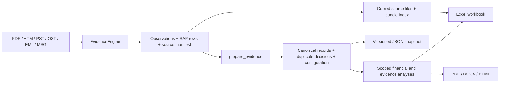

# Architecture

The application collects billing observations, prepares a canonical evidence dataset, and renders Excel, PDF, DOCX and HTML outputs. Reports are generated from records; they do not require an intermediate workbook. A saved workbook can also be imported through the GUI.

## Package responsibilities

| Location | Responsibility and dependencies |
| --- | --- |
| `collectors/engine.py` | Coordinates PDF, HTM, PST/OST and EML/MSG ingestion; keeps records, SAP rows, source identities, counts and errors. |
| `io/adapters/` | Reads external formats with pdfplumber, Beautiful Soup, libpff, stdlib email and optional extract-msg. |
| `processors/preparation.py` | Normalizes monetary meaning and identity, resolves duplicates, preserves provenance and selects analysis records. Uses pandas. |
| `processors/financial.py` | Calculates transaction totals, observed balances and billed daily charges. Uses Decimal for monetary totals. |
| `processors/ledgers.py` | Keeps account, fuel, meter and register analyses separate. Qualifies references in outputs containing several ledgers. |
| `processors/` | Extracts fields and runs billing, matching, compensation and forecasting analyses. Forecasting can use NumPy, SciPy and statsmodels. |
| `models/report_models.py` | Shared computed models consumed by the output formats. |
| `models/report_sections.py` | Format-independent section registry and numbering. |
| `io/writers/` | Builds Excel worksheets and copies/indexes evidence files with openpyxl and python-docx. |
| `io/reporters/` | Renders PDF with ReportLab, DOCX with python-docx, and self-contained HTML. |
| `helpers/` | Date, formatting, identity, Excel, artifact and resource utilities. Some helpers depend on pandas/openpyxl; this is not a stdlib-only layer. |
| `ui/app.py`, `io/cli.py` | User entry points and run orchestration. |
| `writers/` | Compatibility facade for historical helper imports. Some processors still import this facade; strict dependency inversion is not enforced. |

## Evidence flow

Every renderer uses the same preparation functions and pinned valuation date. Each renderer computes its own view of the shared models; there is no application-wide cached analysis result. Workbook-only SAP analyses remain separate from the document reports.

## Monetary and identity contracts

`Amount (£)` retains the original source figure. `Amount Kind`, `Balance (£)` and `Transaction Amount (£)` make its interpretation explicit. Positive transactions increase debt; payments and credits decrease it; a refund of account credit increases the balance toward zero. Transaction totals never add account balance observations.

Legacy records can lack information needed to establish a transaction, unit rate, account identity or cumulative meter reading. These values remain unavailable. An energy unit rate must be extracted or explicitly identified as extracted; dividing a whole bill by kWh does not establish that rate. `Units (kWh)` is consumption and is separate from `Register Reading (kWh)`.

Account, fuel, meter and register identity constrain deduplication and matching. Equal amounts or nearby dates alone do not establish duplicate events. The full source manifest and occurrence metadata are retained even when records are merged.

## Run lifecycle and persistence

The GUI captures configuration, source paths and report options on the main thread before starting a worker. Workers send callbacks through a queue consumed by the Tk main loop. Closing requests cancellation and lets cleanup finish before the interpreter is destroyed.

Each GUI extraction reserves a unique run directory containing its workbook, requested reports, source copies, bundle index, `records.json` and `run.json` status. Several runs cannot overwrite each other's evidence. A report imported from a workbook also reserves its own directory.

CLI extraction respects the explicitly requested workbook destination and creates a unique adjacent source bundle with a JSON snapshot. Optional JSON destinations are supported. Generated files are staged in the destination directory and atomically replaced after generation succeeds. A failed report section fails the report and leaves an existing destination intact.

JSON version 2 preserves canonical and original records, configuration, valuation date, filtered records, duplicate decisions, source metadata, SAP data, counters and errors. Report loading accepts legacy bare record lists and version 1/2 JSON. Routine report loading accepts JSON engine data. The restricted pickle loader remains an internal compatibility API, not a report CLI interchange path.

## Analytical limits

The bundled Ofgem series is a GB-average electricity/direct-debit reference. Comparisons use extracted rates during consumption periods and show unavailable or unassessed results when rate, period, context or benchmark data is missing. They do not determine an account's regional legal cap or statutory compliance.

Credit interest requires a configured rate and is an indicative scenario. It follows nonoverlapping observed credit episodes and actual refund movements. Back-billing compensation uses the union of live consumption slices after superseded invoices are removed. Eligibility still requires review of the original evidence.

Forecasts require at least three consecutive month-end balance observations from one ledger. Missing months prevent projection. Displayed bands are advisory scenarios, not calibrated statistical confidence intervals.

## Build and verification

`pyproject.toml` defines dependencies and limits package discovery to `edf_bill_fetcher`. Executable workflows include the MSG extra and record resolved build dependencies in the distributed artifact. Builds triggered by CI check out the commit that completed CI.

GitHub CI runs linting, formatting, type checking and the full test suite across supported Python versions and operating systems. Application checks also include end-to-end extraction, all four output formats, evidence links, JSON reloads, and GUI snapshot/run-isolation/shutdown behavior.
